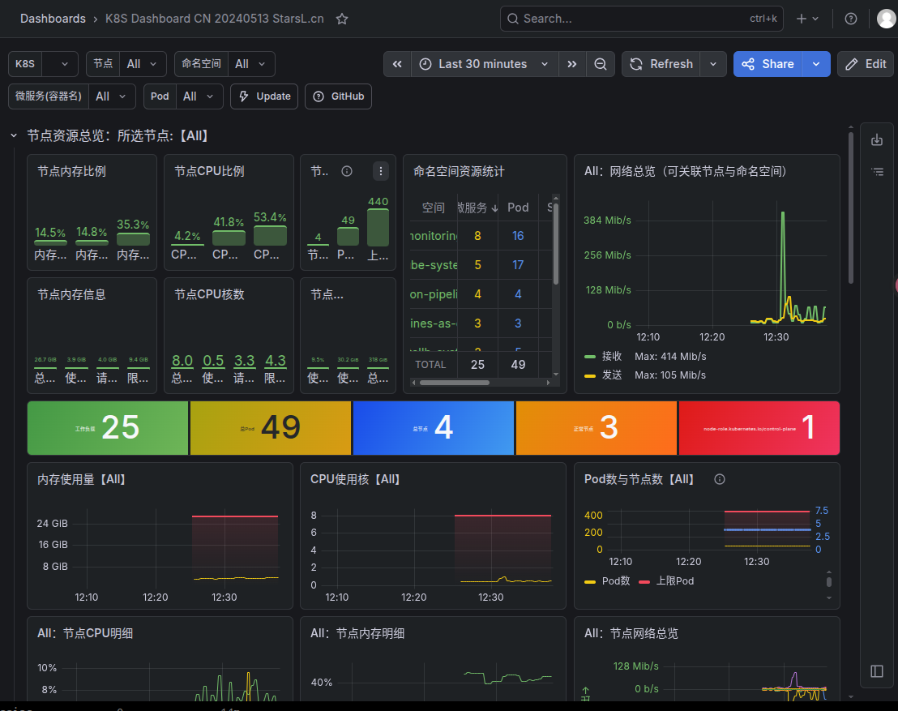
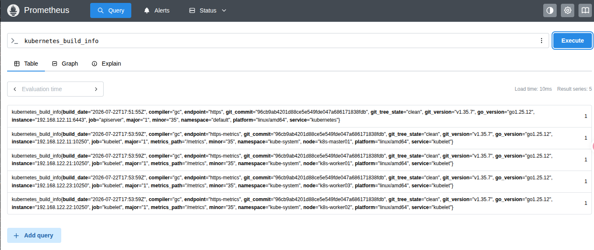
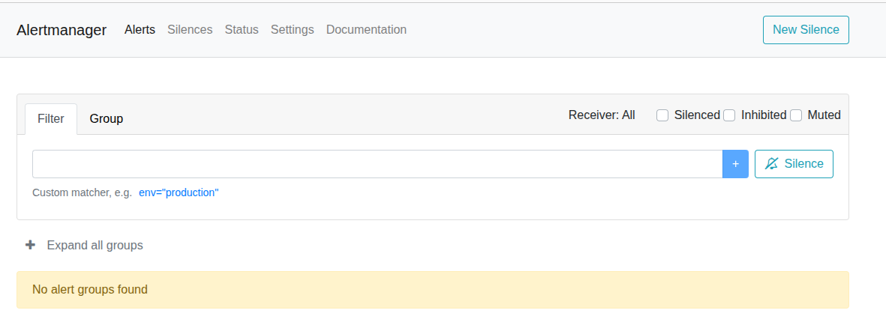
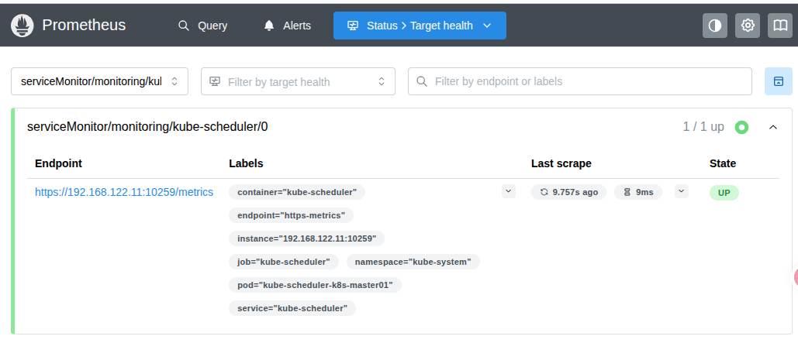
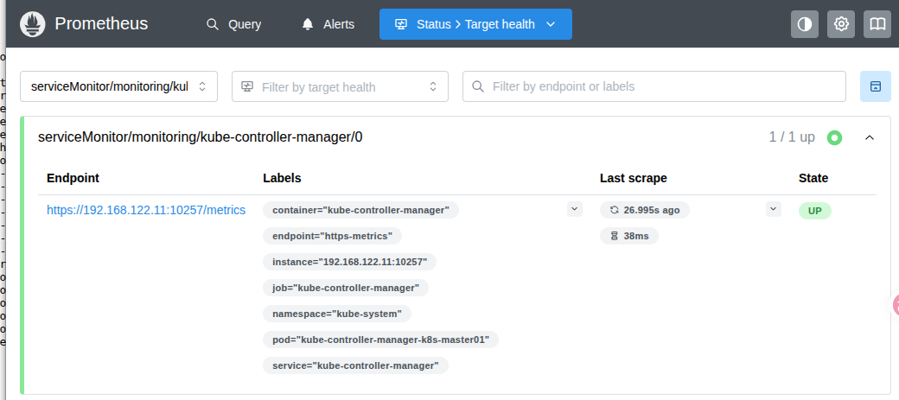
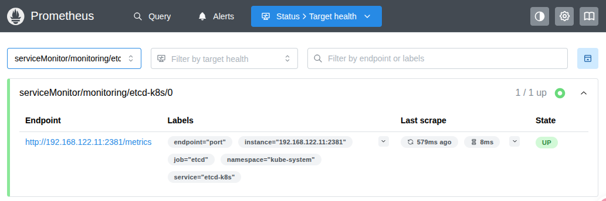

# Kube-prometehus

## Kube-prometheus 安装

### 创建namespace & CRD资源

```
git clone -b release-0.18 https://gh-proxy.org/https://github.com/prometheus-operator/kube-prometheus.git
cd kube-prometheus/
kubectl apply --server-side -f manifests/setup
```

### 持久化数据

```
# prometheus数据持久化
vim manifests/prometheus-prometheus.yaml
  ...
  version: 3.12.0
  # 数据持久化 ,添加如下内容
  retention: 180d
  storage:
    volumeClaimTemplate:
      spec:
        storageClassName: nfs-client
        accessModes: ["ReadWriteOnce"]
        resources:
          requests:
            storage: 200Gi
# alertmanager数据持久化
vim manifests/alertmanager-alertmanager.yaml
  ...
  version: 0.33.0
  # 添加如下内容:
  storage:
    volumeClaimTemplate:
      spec:
        storageClassName: nfs-client
        accessModes: ["ReadWriteOnce"]
        resources:
          requests:
            storage: 10Gi

# Grafana 数据持久化
~/kube-prometheus# cat > manifests/grafana-pvc.yaml << EOF
---
apiVersion: v1
kind: PersistentVolumeClaim
metadata:
  name: grafana-pvc
  namespace: monitoring
spec:
  storageClassName: nfs-client
  accessModes:
    - ReadWriteOnce
  resources:
    requests:
      storage: 10Gi
EOF
vim manifests/grafana-deployment.yaml
      ...
      volumes:
      # 注释下面的内容，声明使用的PVC
      volumes:
      # - emptyDir: {}
      - name: grafana-storage
        persistentVolumeClaim:
          claimName: grafana-pvc

```

### 应用资源清单

```
kubectl apply -f manifests/
kubectl  get pod -n monitoring  
NAME                                   READY   STATUS    RESTARTS   AGE
alertmanager-main-0                    2/2     Running   0          9m8s
alertmanager-main-1                    2/2     Running   0          9m8s
alertmanager-main-2                    2/2     Running   0          9m8s
blackbox-exporter-9f8c5d9fb-sfwvb      3/3     Running   0          9m36s
grafana-667558d6b6-2lvpq               1/1     Running   0          109s
kube-state-metrics-6fccf575d5-q4gnj    3/3     Running   0          9m35s
node-exporter-4ltzc                    2/2     Running   0          9m35s
node-exporter-57d9h                    2/2     Running   0          9m35s
node-exporter-695vz                    2/2     Running   0          9m35s
node-exporter-w49c5                    2/2     Running   0          9m35s
prometheus-adapter-6695cb6f7d-4rxwr    1/1     Running   0          9m34s
prometheus-adapter-6695cb6f7d-rd2bq    1/1     Running   0          9m34s
prometheus-k8s-0                       2/2     Running   0          9m7s
prometheus-k8s-1                       2/2     Running   0          9m7s
prometheus-operator-7f4f4f79d5-t9lt6   2/2     Running   0          9m34s
```

### 使用NodePort暴露服务

```
# prometheus http://192.168.122.11:32090
kubectl patch svc prometheus-k8s -n monitoring --type='merge' -p '{
  "spec": {
    "type": "NodePort",
    "ports": [{
      "port": 9090,
      "targetPort": 9090,
      "nodePort": 32090
    }]
  }
}'
# grafana http://192.168.122.11:32030
kubectl patch svc grafana -n monitoring --type='merge' -p '{
  "spec": {
    "type": "NodePort",
    "ports": [{
      "port": 3000,
      "targetPort": 3000,
      "nodePort": 32030
    }]
  }
}'
# alertmanager http://192.168.122.11:32093
kubectl patch svc alertmanager-main -n monitoring --type='merge' -p '{
  "spec": {
    "type": "NodePort",
    "ports": [{
      "port": 9093,
      "targetPort": 9093,
      "nodePort": 32093
    }]
  }
}'

kubectl  get svc -n monitoring
NAME                    TYPE        CLUSTER-IP       EXTERNAL-IP   PORT(S)                      AGE
alertmanager-main       NodePort    10.105.211.61    <none>        9093:32093/TCP               3m33s
alertmanager-operated   ClusterIP   None             <none>        9093/TCP,9094/TCP,9094/UDP   3m5s
blackbox-exporter       ClusterIP   10.99.15.82      <none>        9115/TCP,19115/TCP           3m33s
grafana                 NodePort    10.102.83.104    <none>        3000:32030/TCP               3m32s
kube-state-metrics      ClusterIP   None             <none>        8443/TCP,9443/TCP            3m32s
node-exporter           ClusterIP   None             <none>        9100/TCP                     3m31s
prometheus-adapter      ClusterIP   10.110.241.197   <none>        443/TCP                      3m31s
prometheus-k8s          NodePort    10.106.82.178    <none>        9090:32090/TCP               3m31s
prometheus-operated     ClusterIP   None             <none>        9090/TCP                     3m3s
prometheus-operator     ClusterIP   None             <none>        8443/TCP                     3m30s
```

### 删除默认的网路策略

需要删除默认的访问策略才能访问到UI

```
 kubectl  delete  networkpolicy -n monitoring --all
```
访问Grafana Dashboard ID: `13105`


访问Prometheus UI



访问Alertmanager UI



### 完善监控

#### 添加kube-scheduler监控

```
# 查看 kube-scheduler 的Service monitoring定义
~/kube-prometheus# cat manifests/kubernetesControlPlane-serviceMonitorKubeScheduler.yaml
apiVersion: monitoring.coreos.com/v1
kind: ServiceMonitor
metadata:
  labels:
    app.kubernetes.io/name: kube-scheduler
    app.kubernetes.io/part-of: kube-prometheus
  name: kube-scheduler
  namespace: monitoring
spec:
  endpoints:
  - bearerTokenFile: /var/run/secrets/kubernetes.io/serviceaccount/token
    interval: 30s
    port: https-metrics
    scheme: https
    tlsConfig:
      insecureSkipVerify: true
  - bearerTokenFile: /var/run/secrets/kubernetes.io/serviceaccount/token
    interval: 5s
    metricRelabelings:
    - action: drop
      regex: process_start_time_seconds
      sourceLabels:
      - __name__
    path: /metrics/slis
    port: https-metrics
    scheme: https
    tlsConfig:
      insecureSkipVerify: true
  jobLabel: app.kubernetes.io/name
  # 通过 selector.matchLabels 匹配 kube-system 这个命名空间下面匹配具有 app.kubernetes.io/name=kube-scheduler标签的 Service 实现自动发现
  namespaceSelector:
    matchNames:
    - kube-system
  selector:
    matchLabels:
      app.kubernetes.io/name: kube-scheduler
# 因为匹配不到所以没法自动发现
~/kube-prometheus# kubectl get svc -n kube-system -l app.kubernetes.io/name=kube-scheduler
No resources found in kube-system namespace.
# 创建具有app.kubernetes.io/name=kube-scheduler标签的 Service 与 ServiceMonitor 进行关联
## 调整 kube-schduler 静态Pod监听端口为 0.0.0.0
vim /etc/kubernetes/manifests/kube-scheduler.yaml
...
spec:
  containers:
  - command:
    - kube-scheduler
    - --authentication-kubeconfig=/etc/kubernetes/scheduler.conf
    - --authorization-kubeconfig=/etc/kubernetes/scheduler.conf
    - --bind-address=0.0.0.0
    - --kubeconfig=/etc/kubernetes/scheduler.conf
    - --leader-elect=true
## 确认更改生效
~# ss -tnlp|grep 10259
LISTEN 0      32768              *:10259            *:*    users:(("kube-scheduler",pid=95096,fd=3))
## 查看当前集群Pod的 Labels
kubectl describe pod kube-scheduler-k8s-master01 -n kube-system|grep -A 3 -i labels
Labels:               component=kube-scheduler
                      tier=control-plane
Annotations:          kubernetes.io/config.hash: b11c69c6646cbac8e949844eea79a5b0
                      kubernetes.io/config.mirror: b11c69c6646cbac8e949844eea79a5b0
## 创建Service对象
mkdir -pv exts
cat  > exts/kube-scheduler-service.yaml << 'EOF'
apiVersion: v1
kind: Service
metadata:
  namespace: kube-system
  name: kube-scheduler
  labels: # 必须和上面的 ServiceMonitor 下面的 matchLabels 保持一致
    app.kubernetes.io/name: kube-scheduler
spec:
  selector:
    component: kube-scheduler
  ports:
    - name: https-metrics
      port: 10259
      targetPort: 10259 # 需要注意现在版本默认的安全端口是10259
EOF
kubectl  apply -f exts/kube-scheduler-service.yaml
kubectl get svc -n kube-system -l app.kubernetes.io/name=kube-scheduler
NAME             TYPE        CLUSTER-IP     EXTERNAL-IP   PORT(S)     AGE
kube-scheduler   ClusterIP   10.98.18.221   <none>        10259/TCP   20s
```


#### 添加kube-controller监控


```
# 查看 kube-controller 的Service monitoring定义
cat manifests/kubernetesControlPlane-serviceMonitorKubeControllerManager.yaml
...
  jobLabel: app.kubernetes.io/name
  namespaceSelector:
    matchNames:
    - kube-system
  selector:
    matchLabels:
      app.kubernetes.io/name: kube-controller-manager
~# kubectl get svc -n kube-system -l app.kubernetes.io/name=kube-controller-manager
No resources found in kube-system namespace.
# 创建具有app.kubernetes.io/name=kube-controller-manager标签的 Service 与 ServiceMonitor 进行关联
## 调整 kube-controller-manager 静态Pod监听端口为 0.0.0.0
vim /etc/kubernetes/manifests/kube-controller-manager.yaml
...
spec:
  containers:
  - command:
    - kube-controller-manager
    - --allocate-node-cidrs=true
    - --authentication-kubeconfig=/etc/kubernetes/controller-manager.conf
    - --authorization-kubeconfig=/etc/kubernetes/controller-manager.conf
    - --bind-address=0.0.0.0
ss -tnlp|grep 10257
LISTEN 0      32768               *:10257            *:*    users:(("kube-controller",pid=2581722,fd=4))   
## 查看当前集群Pod的 Labels
kubectl describe pod kube-controller-manager-k8s-master01 -n kube-system|grep -A 3 -i labels
Labels:               component=kube-controller-manager
                      tier=control-plane
Annotations:          kubernetes.io/config.hash: c765fbe50cdb7ec8a3756e2b8f514fa6
                      kubernetes.io/config.mirror: c765fbe50cdb7ec8a3756e2b8f514fa6
## 创建Service对象
cat  > exts/kube-controller-manager-service.yaml << 'EOF'
apiVersion: v1
kind: Service
metadata:
  namespace: kube-system
  name: kube-controller-manager
  labels:
    app.kubernetes.io/name: kube-controller-manager
spec:
  selector:
    component: kube-controller-manager
  ports:
    - name: https-metrics
      port: 10257
      targetPort: 10257 # controller-manager 的安全端口为10257
EOF
kubectl apply -f exts/kube-controller-manager-service.yaml
kubectl get svc -n kube-system -l app.kubernetes.io/name=kube-controller-manager
NAME                      TYPE        CLUSTER-IP     EXTERNAL-IP   PORT(S)     AGE
kube-controller-manager   ClusterIP   10.110.87.34   <none>        10257/TCP   0s
```


#### 添加etcd监控

```
# 修改etcd监听端口
vim /etc/kubernetes/manifests/etcd.yaml
  containers:
  - command:
    - etcd
    - --advertise-client-urls=https://192.168.122.11:2379
    ...
    - --initial-advertise-peer-urls=https://192.168.122.11:2380
    - --initial-cluster=k8s-master01=https://192.168.122.11:2380
    - --key-file=/etc/kubernetes/pki/etcd/server.key
    - --listen-client-urls=https://192.168.122.11:2379,https://192.168.122.11:2379
    - --listen-metrics-urls=http://0.0.0.0:2381
    - --listen-peer-urls=https://192.168.122.11:2380
ss -tnlp|grep 2380
LISTEN 0      32768  192.168.122.11:2380       0.0.0.0:*    users:(("etcd",pid=2587637,fd=3))                           
ss -tnlp|grep 2381
LISTEN 0      32768               *:2381             *:*    users:(("etcd",pid=2587637,fd=11))  
## 创建 Etcd ServiceMonitor对象
cat > exts/kube-etcd-servicemonitor.yaml << 'EOF'
apiVersion: monitoring.coreos.com/v1
kind: ServiceMonitor
metadata:
  name: etcd-k8s
  namespace: monitoring
  labels:
    k8s-app: etcd-k8s
spec:
  jobLabel: k8s-app
  endpoints:
    - port: port
      interval: 15s
  selector:
    matchLabels:
      k8s-app: etcd
  namespaceSelector:
    matchNames:
      - kube-system
EOF
kubectl  apply -f exts/kube-etcd-servicemonitor.yaml
## 创建Service对象满足 ServiceMonitor 关联条件
cat > exts/kube-etcd-service.yaml << 'EOF'
apiVersion: v1
kind: Service
metadata:
  name: etcd-k8s
  namespace: kube-system
  labels:
    k8s-app: etcd
spec:
  type: ClusterIP
  clusterIP: None
  ports:
    - name: port
      port: 2381
---
apiVersion: v1
kind: Endpoints
metadata:
  name: etcd-k8s
  namespace: kube-system
  labels:
    k8s-app: etcd
subsets:
  - addresses:
      - ip: 192.168.122.11 # 指定etcd节点地址，如果是集群则继续向下添加
        nodeName: etcd-k8s-master01
    ports:
      - name: port
        port: 2381
EOF
kubectl apply -f exts/kube-etcd-service.yaml
kubectl get svc -n kube-system -l k8s-app=etcd
NAME       TYPE        CLUSTER-IP   EXTERNAL-IP   PORT(S)    AGE
etcd-k8s   ClusterIP   None         <none>        2381/TCP   3s
```


## 卸载

```
kubectl delete --ignore-not-found=true -f manifests/ -f manifests/setup
```