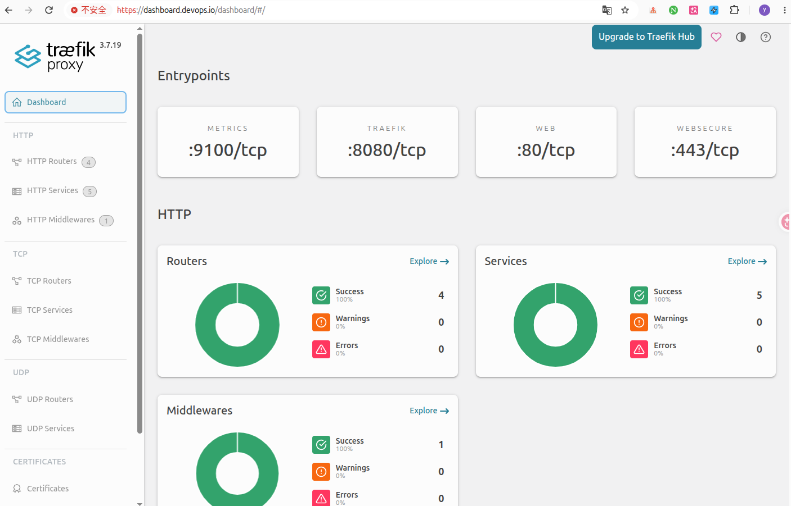

# Traefik


## 安装

```
helm repo add traefik https://traefik.github.io/charts
helm repo update
kubectl create namespace traefik
```
```
openssl req -x509 -nodes -days 365 -newkey rsa:2048 \
  -keyout tls.key -out tls.crt \
  -subj "/CN=*.devops.io"
kubectl create secret tls local-selfsigned-tls \
  --cert=tls.crt --key=tls.key \
  --namespace traefik

wget  https://github.com/kubernetes-sigs/gateway-api/releases/download/v1.6.3/standard-install.yaml
kubectl apply -f standard-install.yaml
#wget https://gh-proxy.org/https://raw.githubusercontent.com/traefik/traefik/v3.7/docs/content/reference/dynamic-configuration/kubernetes-gateway-rbac.yml
#kubectl apply -f kubernetes-gateway-rbac.yml
```

=== "全局HTTPS"

    ```
    helm install traefik traefik/traefik -n traefik \
            --set api.dashboard=true \
            --set api.insecure=false \
            --set ingressRoute.dashboard.enabled=true \
            --set ingressRoute.dashboard.matchRule='Host(`dashboard.devops.io`)' \
            --set ingressRoute.dashboard.entryPoints={websecure} \
            --set providers.kubernetesIngress.enabled=false \
            --set providers.kubernetesGateway.enabled=true \
            --set gateway.listeners.web.port=80 \
            --set gateway.listeners.web.protocol=HTTP \
            --set gateway.listeners.web.namespacePolicy.from=All \
            --set gateway.listeners.websecure.port=443 \
            --set gateway.listeners.websecure.protocol=HTTPS \
            --set gateway.listeners.websecure.namespacePolicy.from=All \
            --set gateway.listeners.websecure.mode=Terminate \
            --set gateway.listeners.websecure.certificateRefs[0].kind=Secret \
            --set gateway.listeners.websecure.certificateRefs[0].name=local-selfsigned-tls \
            --set ports.web.port=80 \
            --set ports.web.nodePort=30000 \
            --set ports.web.http.redirections.entryPoint.to=websecure \
            --set ports.web.http.redirections.entryPoint.scheme=https \
            --set ports.web.http.redirections.entryPoint.permanent=true \
            --set ports.websecure.port=443 \
            --set ports.websecure.nodePort=30001 \
            --set log.level=INFO \
            --set accessLog.enabled=true \
            --set metrics.prometheus.enabled=true \
            --set hub.enabled=false \
            --set hub.namespaces={} \
            --set oci_meta.enabled=false \
            --wait
    ```
        
=== "使用中间件跳转HTTPS"

        helm install traefik traefik/traefik -n traefik \
                --set api.dashboard=true \
                --set api.insecure=false \
                --set ingressRoute.dashboard.enabled=true \
                --set ingressRoute.dashboard.matchRule='Host(`dashboard.devops.io`)' \
                --set ingressRoute.dashboard.entryPoints="{web,websecure}" \
                --set ingressRoute.dashboard.middlewares[0].name=dashboard-auth \
                --set ingressRoute.dashboard.middlewares[1].name=redirect-https \
                --set providers.kubernetesIngress.enabled=false \
                --set providers.kubernetesGateway.enabled=true \
                --set gateway.listeners.web.port=80 \
                --set gateway.listeners.web.protocol=HTTP \
                --set gateway.listeners.web.namespacePolicy.from=All \
                --set gateway.listeners.websecure.port=443 \
                --set gateway.listeners.websecure.protocol=HTTPS \
                --set gateway.listeners.websecure.namespacePolicy.from=All \
                --set gateway.listeners.websecure.mode=Terminate \
                --set gateway.listeners.websecure.certificateRefs[0].kind=Secret \
                --set gateway.listeners.websecure.certificateRefs[0].name=local-selfsigned-tls \
                --set ports.web.port=80 \
                --set ports.web.nodePort=30000 \
                --set ports.websecure.port=443 \
                --set ports.websecure.nodePort=30001 \
                --set log.level=INFO \
                --set accessLog.enabled=true \
                --set metrics.prometheus.enabled=true \
                --set hub.enabled=false \
                --set hub.namespaces={} \
                --set oci_meta.enabled=false \
                --wait
        kubectl apply -f - << EOF
        apiVersion: traefik.io/v1alpha1
        kind: Middleware
        metadata:
        name: redirect-https
        namespace: traefik
        spec:
        redirectScheme:
            scheme: https
            permanent: true
        EOF 
```
 kubectl  get all -n traefik
NAME                           READY   STATUS    RESTARTS   AGE
pod/traefik-6469dfcfbf-64f4j   1/1     Running   0          40s

NAME              TYPE           CLUSTER-IP      EXTERNAL-IP       PORT(S)                      AGE
service/traefik   LoadBalancer   10.109.35.153   192.168.122.140   80:30000/TCP,443:30001/TCP   40s

NAME                      READY   UP-TO-DATE   AVAILABLE   AGE
deployment.apps/traefik   1/1     1            1           40s

NAME                                 DESIRED   CURRENT   READY   AGE
replicaset.apps/traefik-6469dfcfbf   1         1         1       41s
```

## 访问 UI

仪表盘通过 Chart 提供的IngressRoute对外开放，这是我们在安装过程中在 helm 值中定义的。访问地址：`https://dashboard.devops.io/dashboard/`



## 部署案例

```
# 1. 创建部署
kubectl apply -f - << EOF
apiVersion: apps/v1
kind: Deployment
metadata:
  name: whoami
spec:
  replicas: 2
  selector:
    matchLabels:
      app: whoami
  template:
    metadata:
      labels:
        app: whoami
    spec:
      containers:
        - name: whoami
          image: traefik/whoami
          ports:
            - containerPort: 80
EOF
# 2. 创建服务
kubectl apply -f - << EOF
apiVersion: v1
kind: Service
metadata:
  name: whoami
spec:
  ports:
    - port: 80
  selector:
    app: whoami
EOF
# 3. 创建入口路由
kubectl apply -f - << 'EOF'
apiVersion: traefik.io/v1alpha1
kind: IngressRoute
metadata:
  name: whoami
spec:
  entryPoints:
    - websecure # 走https
  routes:
    - match: Host(`whoami.devops.io`)
      kind: Rule
      services:
        - name: whoami
          port: 80
EOF
# 4. 验证
curl  -k -H 'host: whoami.devops.io' https://192.168.122.140
Hostname: whoami-7cc8b8c9b-8pp9t
IP: 127.0.0.1
IP: ::1
IP: 10.244.79.77
IP: fe80::8cd9:48ff:fe6e:a145
RemoteAddr: 10.244.79.76:34468
GET / HTTP/1.1
Host: whoami.devops.io
User-Agent: curl/8.5.0
Accept: */*
Accept-Encoding: gzip
X-Forwarded-For: 10.244.32.128
X-Forwarded-Host: whoami.devops.io
X-Forwarded-Port: 443
X-Forwarded-Proto: https
X-Forwarded-Server: traefik-6469dfcfbf-64f4j
X-Real-Ip: 10.244.32.128

```
